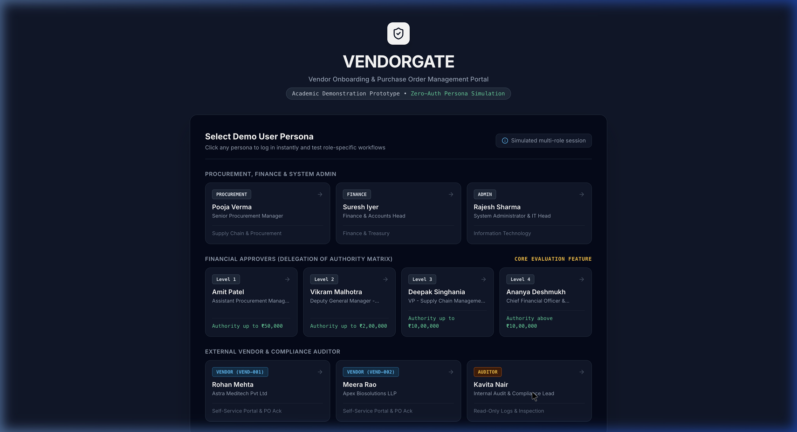
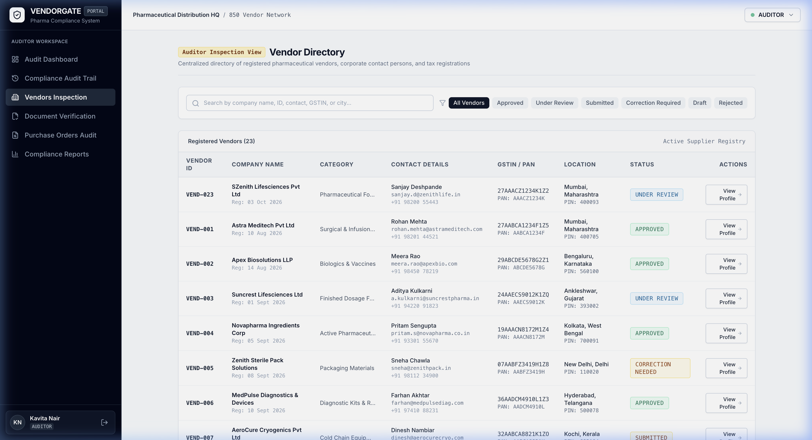
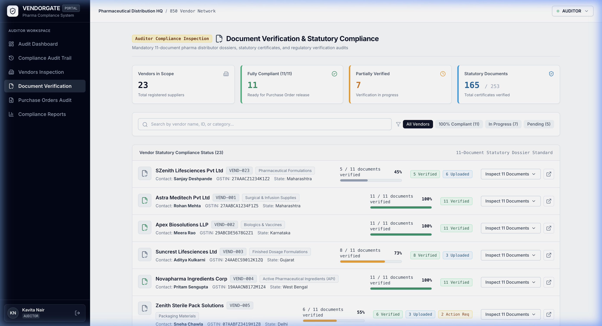
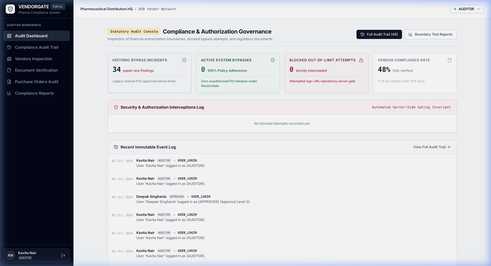
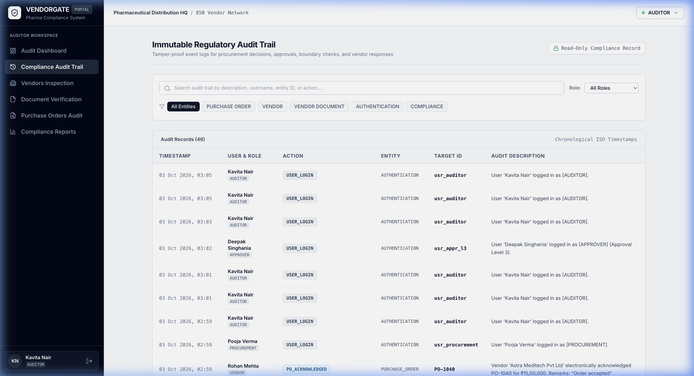
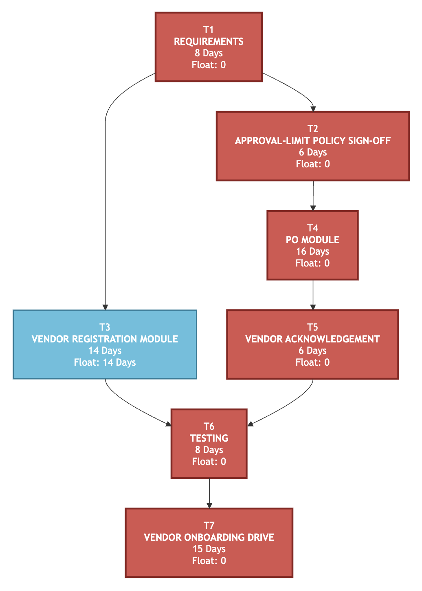

# 🏥 VendorGate
### Enterprise Vendor Qualification & Purchase Order Governance System
**Software Engineering & Project Management (SEPM) Enterprise Capstone Project**

[](https://nodejs.org/)
[](https://react.dev/)
[](https://www.typescriptlang.org/)
[](https://tailwindcss.com/)
[](https://expressjs.com/)
[-success?style=for-the-badge&logo=checkmarx&logoColor=white)](https://github.com/Whatisthissam/VendorGate)
[](Documentations/ProjectPlan_VendorGate.pdf)

---

## 📌 Executive Summary & Problem Statement

**VendorGate** is an enterprise-grade vendor qualification, statutory document compliance, and purchase order governance portal developed for a mid-sized pharmaceutical distributor managing an active ecosystem of over **850 registered healthcare suppliers**.

### ⚠️ The Problem in Legacy Manual Operations
Prior to the implementation of VendorGate, the organization operated through fragmented, unmonitored manual procedures:
* **Unsecured Document Exchanges:** Prospective vendors emailed statutory drug licenses, tax certificates, and banking credentials over unsecured email threads with zero cryptographic validation or version control.
* **Severe Financial & Regulatory Audit Exposure:** Internal statutory compliance audits uncovered **34 unauthorized purchase orders approved above the approving manager's financial limit**, exposing the firm to severe regulatory penalties under CDSCO guidelines and significant financial liability.
* **Delivery & Fulfillment Disputes:** Purchase orders were distributed via unverified email attachments, leaving procurement without verifiable legal timestamps, acknowledgement status, or delivery commitments.
* **Siloed Approvals & Lack of Segregation:** Higher-tier officers signed off on lower-value requisitions while junior officers routinely bypassed organizational delegation-of-authority matrices.

### 🛡️ The VendorGate Enterprise Solution
1. **Digital Vendor Onboarding:** Self-service qualification workflow collecting commercial, banking, statutory tax, and regulatory licensing details.
2. **11-Document Pharmaceutical Dossier:** Standardized inspection checklist verifying all statutory Indian pharma credentials (CDSCO 20B/21B, GST, PAN, WHO-GMP, etc.).
3. **Exact-Tier Managerial Authority Routing:** Automated policy engine matching requisitions to their designated financial approval tier (Level 1 through Level 4).
4. **Strict Approval Bypass Prevention:** Real-time server-side gating blocking unauthorized approvals and logging tamper-evident audit records.
5. **Electronic Vendor Acknowledgement:** Dedicated portal for suppliers to inspect released purchase orders, enter dispatch notes, and record digital acknowledgements.
6. **Immutable Audit Trail:** Read-only compliance log capturing all lifecycle actions, policy blocks, decisions, and system events.

---

## 📸 Application Visual Walkthrough

Here is a look at the key interfaces and workflows across the VendorGate portal:

### 1. Enterprise Multi-Persona Authentication Portal
Role-gated login matrix organized cleanly by organizational hierarchy: Procurement, Finance, Admin at the top; Delegation of Authority Financial Approvers (Levels 1–4) in the middle; and Suppliers / Statutory Auditor at the base.


### 2. Clean Vendor Directory & Supplier Master
Centralized repository displaying registered pharmaceutical suppliers, corporate contacts, GSTIN/PAN tax identifiers, geographic operational zones, and corporate profiles without document clutter.


### 3. Dedicated 11-Document Statutory Verification & Compliance Console
Interactive dossier inspection console tracking overall regulatory health across suppliers, progress metrics ($X/11$ documents), real-time compliance percentages, and expandable document checklists.


### 4. Statutory Audit Console (Kavita Nair, Lead Auditor)
Dedicated audit workspace highlighting the invariant of **0 Active System Bypasses** under VendorGate compared against **34 Historic Paper-Era Incidents**, alongside intercepted unauthorized attempts and statutory compliance percentages.


### 5. Immutable Regulatory Compliance Audit Trail
Chronological, read-only event log recording every action: vendor onboarding, document approvals, purchase order submissions, policy gate blocks, and vendor acknowledgements.


---

## 🏛️ System Architecture & UML Design Artifacts

VendorGate's software engineering foundation was designed according to rigorous software development standards. All structural and behavioral models are documented below:

### A. Approval-Level Decision Flow
Automated financial delegation engine that deterministically computes the required approval tier from line-item pricing ($Quantity \times Unit\ Price$) and enforces exact-tier authorization.


### B. Purchase Order State Transition Diagram
Finite state machine governing the complete lifecycle of a pharmaceutical procurement order from Draft through electronic Supplier Acknowledgement.


### C. System Activity Diagram
End-to-end multi-role operational workflow from initial vendor registration, document verification, PO drafting, policy gating, to goods receipt.


### D. System Sequence Diagram
Chronological interaction flow between the Frontend Client, Express REST Controllers, Policy Middleware, and In-Memory Data Store.


### E. Domain Class Diagram
Object-oriented class hierarchy detailing relationships between `User`, `Vendor`, `VendorDocument`, `PurchaseOrder`, `ApprovalHistory`, and `AuditLog`.


### F. Use Case Diagram
Actor-to-feature mapping defining permissions for Administrator, Procurement Specialist, Approver Tiers (L1–L4), Finance Officer, Vendor, and Statutory Auditor.


---

## ⚖️ Delegation of Authority & Strict Level Matching

### Financial Approval Tiers
Requisitions are automatically categorized into financial approval levels based on line-item requisition values:

| Authority Tier | Requisition Value Threshold | Designated Approver Persona | Corporate Title | Primary Governance Scope |
| :---: | :---: | :---: | :---: | :--- |
| **Level 1** | $\le ₹50,000$ | **Amit Patel** | Assistant Procurement Manager | Small operational consumables, routine office supplies |
| **Level 2** | $₹50,001 \text{ to } ₹2,00,000$ | **Vikram Malhotra** | Deputy General Manager (Operations) | Regular warehouse replenishment, packaging consignments |
| **Level 3** | $₹2,00,001 \text{ to } ₹10,00,000$ | **Deepak Singhania** | Vice President (Supply Chain) | Bulk pharmaceutical consignments, sterile formulations |
| **Level 4** | $> ₹10,00,000$ | **Ananya Deshmukh** | Chief Financial Officer (Executive) | Capital expenditures, high-value biologic consignments |

### 🔒 The Exact-Tier Invariant (Strict Matching)
To eliminate rogue purchases and enforce strict managerial accountability:
* **Level 1 POs** $\rightarrow$ **Only Level 1 Approver** (Amit Patel) can approve.
* **Level 2 POs** $\rightarrow$ **Only Level 2 Approver** (Vikram Malhotra) can approve.
* **Level 3 POs** $\rightarrow$ **Only Level 3 Approver** (Deepak Singhania) can approve.
* **Level 4 POs** $\rightarrow$ **Only Level 4 Approver** (Ananya Deshmukh) can approve.
* **Cross-Tier Prevention:** A higher-tier officer (e.g., Level 4 CFO) is strictly blocked from approving a Level 1 or Level 2 purchase order, ensuring lower-tier managers remain accountable for departmental budgets.
* **Server-Side Enforcement:** Attempted bypasses return `HTTP 403 Forbidden` and log an immutable `UNAUTHORIZED_APPROVAL_BLOCKED` incident to the audit trail.

---

## 📋 The 11 Statutory Pharmaceutical Documents

Under Indian pharmaceutical distribution and CDSCO statutory norms, vendors must submit and verify the following 11 regulatory certifications before purchase order release:

| # | Statutory Document Name | Issuing Authority / Regulatory Norm | Validation Criteria |
| :-: | :--- | :--- | :--- |
| **01** | **GST Registration Certificate** | Form GST REG-06 / GSTN Portal | Active status, matching corporate legal entity name |
| **02** | **Permanent Account Number (PAN)** | Income Tax Department of India | Entity identity check, 4th character entity type match |
| **03** | **Company Incorporation Certificate** | Ministry of Corporate Affairs (MCA) | Valid CIN / LLPIN registration, date of incorporation |
| **04** | **Bank Mandate & Cancelled Cheque** | Commercial Banking Institution | Valid IFSC, active account name matching corporate entity |
| **05** | **Wholesale Drug License (20B / 21B)** | State FDA / CDSCO | Valid licensing for non-biological & biological distribution |
| **06** | **Registered Premises Proof** | Municipal Authority / Lease Deed | Verifiable warehouse/office physical premises address |
| **07** | **MSME / Udyam Certificate** | Ministry of Micro, Small & Medium Enterprises | Enterprise classification (Micro, Small, Medium) |
| **08** | **Municipal Trade License** | Local Municipal Corporation | Valid operating authorization for commercial trade |
| **09** | **WHO-GMP / ISO 9001 Certificate** | Accredited Quality Certification Registrar | Current Good Manufacturing Practices compliance |
| **10** | **Tax Clearance Certificate** | Income Tax / Commercial Tax Authority | Assessment compliance, no pending statutory arrears |
| **11** | **Board Resolution / Authorized Signatory** | Board of Directors / Partner Authority | Legal authorization for official contract signing |

---

## 📊 Software Project Management (SPM) Analysis

### Critical Path Method (CPM) 59-Day Schedule
The project planning and scheduling was modeled using CPM to identify critical path tasks and manage float:

$$\text{T1 (8d)} \longrightarrow \text{T2 (6d)} \longrightarrow \text{T4 (16d)} \longrightarrow \text{T5 (6d)} \longrightarrow \text{T6 (8d)} \longrightarrow \text{T7 (15d)} = \mathbf{59\text{ Working Days}}$$

*(Note: Task T3 — Vendor Registration Module — possesses **14 days of total float (slack)** and does not delay overall delivery).*



### Work Breakdown Structure (WBS)
* **1.0 Inception & Business Requirements:** Stakeholder interviews, CDSCO regulatory mapping, BRD sign-off.
* **2.0 System Architecture & Formal Specification:** IEEE 830 SRS creation, UML structural and behavioral modeling.
* **3.0 Policy Engine & Core Services Development:** Delegation-of-authority matrix, boundary computation algorithms.
* **4.0 Supplier Portal & Document Management:** 11-document statutory checklist, simulated file uploads.
* **5.0 Purchase Order Workflow Engine:** Drafting, submitting, approving, rejecting, and vendor acknowledgement.
* **6.0 Quality Assurance & Boundary Testing:** Automated test suites, edge case verification, security audits.
* **7.0 Deployment, Training & Pilot Onboarding:** Supplier migration, user acceptance testing (UAT).

### Risk Management Matrix
| Risk ID | Identified Risk Description | Probability ($P$) | Impact ($I$) | Risk Exposure ($P \times I$) | Mitigation Strategy |
| :---: | :--- | :---: | :---: | :---: | :--- |
| **$R_1$** | Delayed sign-off on approval thresholds | 0.5 | 7 | **3.5** | Pre-schedule executive workshops; secure interim DOA approval |
| **$R_2$** | Ownership disputes between Procurement & Finance | 0.5 | 6 | **3.0** | Clear RACI matrix signed off in Project Charter |
| **$R_3$** | Suppliers resist digital 11-document upload | 0.3 | 6 | **1.8** | Supplier helpdesk; transitional assisted onboarding support |
| **$R_4$** | Approval limit bypass attempts during cutover | 0.2 | 9 | **1.8** | Hardcoded server-side policy gate rejecting unauthorized calls |

---

## 🧪 Comprehensive Automated Test Evidence

VendorGate includes an automated test harness validating all Functional Requirements, boundary cases, and security controls:

```text
========================================================================
  VENDORGATE: 12 FUNCTIONAL REQUIREMENTS (FR-01 to FR-12) AUDIT TEST
========================================================================

[PASS] FR-01: Vendor registration accepts vendor info, creates 11 documents, and sets status to Submitted
[PASS] FR-02: Incomplete registration missing required fields is rejected with 400 & feedback
[PASS] FR-03: Vendor details and registration info can be edited and persisted to state
[PASS] FR-04: Procurement can create PO with unique PO ID in initial status Draft
[PASS] FR-05: Draft PO submitted into approval workflow with applicable approval level (Level 1)
[PASS] FR-06: PO <= ₹50,000 (PO-001: ₹35,000) routed and approved by Level 1 authority Amit Patel
[PASS] Approval Control: Bypass prevention: Level 1 approver blocked from approving Level 2 PO
[PASS] FR-07: PO > ₹50,000 & <= ₹2,00,000 (PO-002: ₹1,50,000) approved by Level 2 authority Vikram Malhotra
[PASS] FR-08: PO > ₹2,00,000 & <= ₹10,00,000 (PO-003: ₹7,50,000) approved by Level 3 authority Deepak Singhania
[PASS] FR-09: PO > ₹10,00,000 (PO-004: ₹15,00,000) approved by Level 4 Executive authority Ananya Deshmukh
[PASS] FR-10: Authorized approver can reject PO with recorded decision, timestamp, comments
[PASS] FR-11: Vendor electronically acknowledges approved PO, moving status to Acknowledged
[PASS] FR-11 Security: Vendor cannot acknowledge POs belonging to competitor/different vendor
[PASS] FR-12: Auditor Kavita Nair can review read-only PO approval records, amounts, approvers, decisions

TOTAL 12-FR AUDIT RESULT: 14 / 14 PASSED (100%)

========================================================================
  VENDORGATE: AUTOMATED BOUNDARY VALUE & AUTHORITY POLICY VERIFICATION
========================================================================

TEST SUITE 1: BOUNDARY VALUE ROUTING
[PASS] Case 1: ₹    49,999 -> Calculated: Level 1 | Expected: Level 1 | Boundary: < ₹50,000 threshold
[PASS] Case 2: ₹    50,000 -> Calculated: Level 1 | Expected: Level 1 | Boundary: Exact Level 1 ceiling
[PASS] Case 3: ₹    50,001 -> Calculated: Level 2 | Expected: Level 2 | Boundary: +₹1 above Level 1 ceiling
[PASS] Case 4: ₹  1,99,999 -> Calculated: Level 2 | Expected: Level 2 | Boundary: < ₹2,00,000 threshold
[PASS] Case 5: ₹  2,00,000 -> Calculated: Level 2 | Expected: Level 2 | Boundary: Exact Level 2 ceiling
[PASS] Case 6: ₹  2,00,001 -> Calculated: Level 3 | Expected: Level 3 | Boundary: +₹1 above Level 2 ceiling
[PASS] Case 7: ₹  9,99,999 -> Calculated: Level 3 | Expected: Level 3 | Boundary: < ₹10,00,000 threshold
[PASS] Case 8: ₹ 10,00,000 -> Calculated: Level 3 | Expected: Level 3 | Boundary: Exact Level 3 ceiling
[PASS] Case 9: ₹ 10,00,001 -> Calculated: Level 4 | Expected: Level 4 | Boundary: +₹1 above Level 3 ceiling

TEST SUITE 2: APPROVAL RESTRICTION & EXACT TIER AUTHORITY GATING
[PASS] Authority Restriction Test (Level 2 user on ₹5,00,000 PO): Blocked as expected
[PASS] Authority Grant Test (Level 3 user on ₹5,00,000 PO): Allowed as expected
[PASS] Strict Level Matching Test (Level 4 user on Level 1 PO): Blocked as expected
[PASS] Exact Tier Match Test (Level 1 user on Level 1 PO): Allowed as expected

TOTAL BOUNDARIES & EXACT TIER RESULT: 13 / 13 PASSED (100%)

========================================================================
  VENDORGATE: ROLE ISOLATION & TAILORED WORKSPACE VERIFICATION
========================================================================

[PASS] Vendor querying /api/vendors only receives their own company record
[PASS] Vendor attempting to inspect competitor vendor dossier is blocked with 403 Forbidden
[PASS] Vendor inspecting their own compliance dossier succeeds (200 OK)
[PASS] Vendor querying /api/purchase-orders only receives POs assigned to their company
[PASS] Vendor attempting to inspect competitor PO detail is blocked with 403 Forbidden
[PASS] Vendor attempting to create PO is blocked with 403 Forbidden
[PASS] Vendor attempting to access internal audit logs is blocked with 403 Forbidden
[PASS] Auditor successfully accesses immutable audit logs (200 OK)
[PASS] Vendor cannot access Academic Project Overview (403 Forbidden)
[PASS] Auditor cannot access Academic Project Overview (403 Forbidden)
[PASS] Administrator can access Academic Project Overview (59-Day CPM confirmed)
[PASS] Vendor dashboard stats contains tailored vendorData (distributor relationship & 11-doc compliance)
[PASS] Auditor dashboard stats contains 34 historic findings vs 0 active bypasses invariant

TOTAL ROLE ISOLATION RESULT: 13 / 13 PASSED (100%)

========================================================================
OVERALL CUMULATIVE TEST SUITE RESULT: 40 / 40 PASSED (100%)
========================================================================
```

---

## 🚀 Future Scope & Production Roadmap

VendorGate is architected to scale into an enterprise-wide pharmaceutical procurement cloud. Future development initiatives include:

1. **AI/OCR Automated Document Verification:**
   * Integrate optical character recognition (Tesseract / Google Cloud Document AI) to automatically parse GSTIN, PAN, and Drug License certificates.
   * Cross-reference parsed data against live government registry APIs (GSTN portal, MCA-21, CDSCO database) for instant automated verification.
2. **ERP & Accounting System Integration:**
   * Native two-way connectors for SAP S/4HANA, Oracle NetSuite, and Tally Prime.
   * Automatic synchronization of Goods Receipt Notes (GRN), 3-way invoice matching ($PO = GRN = Invoice$), and automated payment release.
3. **Smart Contracts & Blockchain-Backed Audit Trail:**
   * Transition the in-memory/relational audit log into a permissioned consortium blockchain (Hyperledger Fabric).
   * Guarantee mathematically tamper-proof compliance trails for statutory FDA/CDSCO inspections.
4. **Cold-Chain & IoT Temperature Telemetry:**
   * Ingest real-time temperature logger data for vaccines and biologics directly into the PO acknowledgement view.
   * Automatically flag temperature breaches during transit before goods acceptance.
5. **Dynamic Supplier Risk Scoring & Performance Analytics:**
   * Machine learning model assessing suppliers on delivery latency, batch rejection ratios, price competitiveness, and license expiry proximity.
6. **Digital Signatures (DSC / Aadhaar eSign):**
   * Support for Class 3 Digital Signature Certificates (DSC) and Aadhaar eSign under the Information Technology Act, 2000 for Level 3 and Level 4 executive authorizations.
7. **Native Mobile Applications for On-the-Go Approvers:**
   * iOS & Android mobile apps (React Native) enabling executives to review line items and authorize emergency high-value requisitions with biometric authentication.

---

## 📚 Project Documentation Index

All formal Software Engineering & Project Management documentation artifacts are preserved in the `Documentations/` directory:

| Document Code | Artifact Title | Description | Link |
| :--- | :--- | :--- | :--- |
| **BRD** | Business Requirements Document | Problem statement, operational context, business requirements | [BRD_VendorGate.pdf](Documentations/BRD_VendorGate.pdf) |
| **SRS** | Software Requirements Specification | IEEE 830 compliant functional and non-functional specifications | [SRS_VendorGate.pdf](Documentations/SRS_VendorGate.pdf) |
| **SOW** | Statement of Work | Project scope, contractual deliverables, and milestone schedule | [SOW_VendorGate.pdf](Documentations/SOW_VendorGate.pdf) |
| **PMP** | Project Management Plan | CPM schedule, WBS, Gantt timelines, resource allocation | [ProjectPlan_VendorGate.pdf](Documentations/ProjectPlan_VendorGate.pdf) |
| **RTM** | Requirements Traceability Matrix | Bidirectional mapping from requirements to design and test cases | [RequirementsTraceabilityMatrix_VendorGate.pdf](Documentations/RequirementsTraceabilityMatrix_VendorGate.pdf) |
| **UML** | UML Architecture Specification | Complete structural, behavioral, and architectural UML diagrams | [UMLPackages_VendorGate.pdf](Documentations/UMLPackages_VendorGate.pdf) |
| **TP&E** | Test Plan & Evidence Document | Equivalence partitioning, boundary value analysis, test logs | [TestPlan&Evidence_VendorGate.pdf](Documentations/TestPlan&Evidence_VendorGate.pdf) |
| **SP** | Agile Sprint Planner | Sprint backlog, user stories, velocity metrics, burn-down data | [SprintPlanner_VendorGate.pdf](Documentations/SprintPlanner_VendorGate.pdf) |
| **RR&CN** | Risk Register & Closure Note | Risk treatment matrix, project retrospectives, project sign-off | [RiskRegister&ClosureNote_VendorGate.pdf](Documentations/RiskRegister&ClosureNote_VendorGate.pdf) |

---

## 🛠️ Quickstart & Local Setup

### System Prerequisites
* **Node.js:** version $\ge 18.0.0$ (LTS recommended)
* **npm:** version $\ge 9.0.0$

### 1. Installation
Clone the repository and install all monorepo dependencies:
```bash
git clone https://github.com/Whatisthissam/VendorGate.git
cd VendorGate
npm install
npm --prefix server install
npm --prefix client install
```

### 2. Launch Development Environment
Run both frontend and backend concurrently with a single command:
```bash
node start-dev.js
```
* **Frontend Portal:** [http://localhost:5173](http://localhost:5173)
* **Backend REST API:** [http://localhost:5001](http://localhost:5001)

### 3. Run Automated Verification Tests
Execute the complete test suite (12 Functional Requirements, Boundary Value Analysis, and Role Isolation):
```bash
npm test
```

---

## 👥 Authors & Academic Credits

* **Project:** VendorGate — Vendor Qualification & Purchase Order Governance System
* **Course:** Software Engineering & Project Management (SEPM)
* **Institution:** Major Project Capstone
* **Repository:** [https://github.com/Whatisthissam/VendorGate](https://github.com/Whatisthissam/VendorGate)
